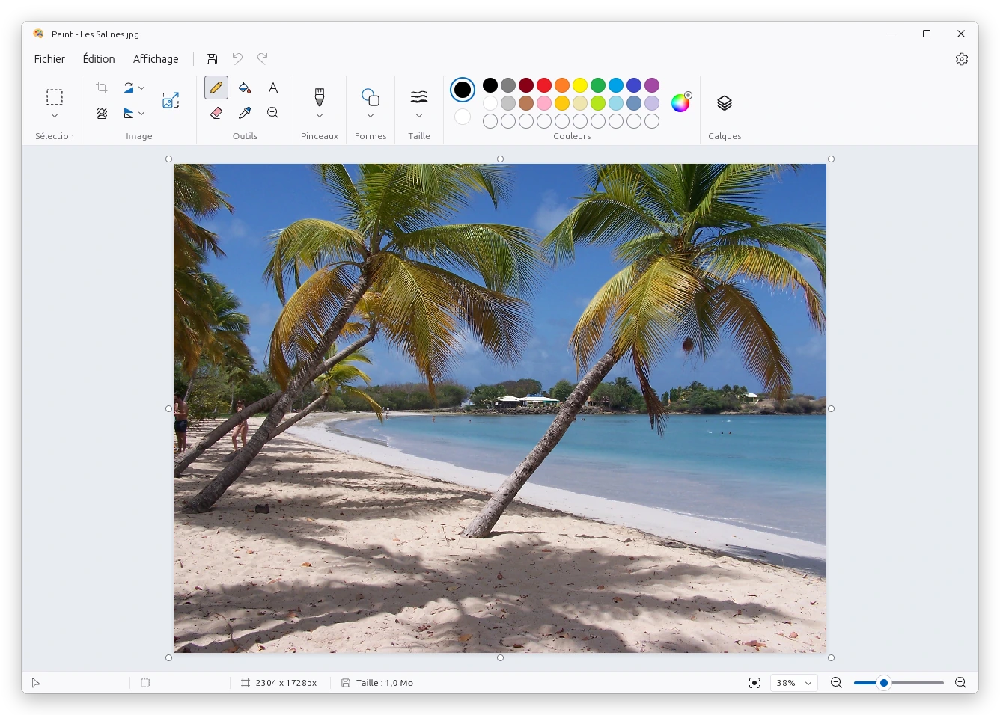

# Paint

Éditeur d'images matricielles inspiré de Paint pour Windows 11, écrit en **Rust**.
Le moteur de dessin est compilé en **WebAssembly**. L'application de bureau
multiplateforme utilise **Tauri**. Linux est la cible prioritaire (.deb, .rpm, AppImage).



<sub>Application de bureau sous Linux. Photo : plage des Salines (Martinique), Nicolas Bouthors,
domaine public, [Wikimedia Commons](https://commons.wikimedia.org/wiki/File:Martinique_Beach_%28Salines%29.jpg).</sub>

## Architecture

```
crates/paint-core   Moteur en Rust pur : calques, outils, pinceaux, formes, sélection,
                    historique (annuler/rétablir), presse-papiers, codecs (PNG, JPEG, BMP,
                    GIF, TIFF, WEBP, ICO). Aucune dépendance au navigateur, entièrement testé.
crates/paint-wasm   Liaisons wasm-bindgen : le moteur compilé en WebAssembly (ui/pkg).
ui/                 Interface (HTML/CSS/JS) qui transmet les événements au moteur et
                    affiche l'image directement depuis la mémoire WebAssembly.
src-tauri/          Application de bureau en Rust (Tauri 2) : fenêtre, presse-papiers
                    système (GTK sous Linux, arboard sous Windows/macOS), fichiers,
                    boîtes de dialogue, ouverture d'un fichier passé en ligne de commande.
```

Toute la logique (outils, sélection, poignées, historique) se trouve dans le moteur Rust.
L'interface se contente de lui transmettre les événements de pointeur et les commandes.

## Fonctionnalités

- **Sélection** : rectangle et forme libre ; déplacement, copie (Ctrl+glisser), redimensionnement
  avec 8 poignées (Maj = proportions), flèches du clavier, sélectionner tout, inverser, supprimer,
  sélection transparente, rogner, menu contextuel (clic droit).
- **Presse-papiers système** : couper/copier/coller des images entre Paint et les autres
  applications ; le collage d'une image plus grande que le canevas l'agrandit ; « Coller depuis un fichier ».
- **Outils** : crayon, remplissage (tolérance), texte (police, taille, gras, italique, souligné,
  barré, fond opaque), gomme (clic droit = remplacement de couleur), sélecteur de couleur, loupe.
- **Pinceaux** : pinceau, calligraphie 1 et 2, aérographe, huile, pastel, marqueur, crayon naturel, aquarelle.
- **Formes (23)** : ligne, courbe (2 inflexions), ovale, rectangles, polygone, triangles, losange,
  pentagone, hexagone, 4 flèches, 3 étoiles, 3 bulles, cœur, éclair ; contour/remplissage ;
  forme modifiable (déplacer, redimensionner, recolorer) jusqu'à validation.
- **Image** : rogner, redimensionner et incliner, rotations, retournements, suppression
  de l'arrière-plan, propriétés (taille du canevas), poignées de redimensionnement du canevas sur les 8 côtés.
- **Calques** : ajouter, dupliquer, fusionner vers le bas, supprimer, masquer, réordonner
  (boutons ou glisser), renommer, miniatures.
- **Couleurs** : couleur 1 et 2, palette de 20 couleurs + 10 personnalisées, éditeur TSV/RVB/hex.
- **Affichage** : zoom de 10 % à 800 % (molette + Ctrl, curseur, préréglages, ajuster à la
  fenêtre), règles, quadrillage, barre d'état, plein écran, thème clair/sombre, français/anglais.
- **Fichiers** : ouvrir, enregistrer, enregistrer sous (7 formats), imprimer, glisser-déposer,
  confirmation des modifications non enregistrées (y compris à la fermeture).
- **Annuler / Rétablir** : flèches à côté d'Enregistrer, Ctrl+Z / Ctrl+Y, boutons Précédent / Suivant
  de la souris, et dans la version web les boutons Précédent / Suivant du navigateur (la page
  n'est pas quittée).
- **Fenêtre (Linux)** : barre de titre intégrée comme Windows 11 (icône, titre, Réduire,
  Agrandir/Restaurer, Fermer), déplacement par la barre, redimensionnement par les bords.
- **Icônes** : celles de Paint Windows 11 en SVG — glyphes Fluent UI System Icons de Microsoft
  (licence MIT, voir `ui/icons/LICENSE-fluent.txt`) et pictogrammes propres à Paint redessinés.

## Lancer Paint

```bash
./run --web        # version web : compile le moteur WASM, sert l'appli et ouvre le navigateur
./run --linux      # application de bureau Linux (ajouter --release pour la version optimisée)
```

Autres modes : `./run --package` (paquets .deb/.rpm/AppImage), `./run --web-build [dossier]`
(site statique à héberger), `./run --test` (toutes les suites de tests), `./run --help`.
`./run --web --host 0.0.0.0 --port 8080` rend la version web accessible sur le réseau local.

La version web est une application installable (PWA) : bouton « Installer » du navigateur.
Une fois chargée, elle fonctionne hors ligne. Elle s'ouvre aussi avec « Ouvrir avec » pour les images.

### Avec Docker

```bash
docker compose up -d      # construit l'image et démarre Paint : http://localhost:8088/
docker compose down       # arrête Paint
```

Aucun outil n'est nécessaire en dehors de Docker : l'image compile le moteur Rust en
WebAssembly, puis sert la version web avec nginx. Le conteneur tourne sans root, en lecture
seule, sans capacités système, et redémarre tout seul avec Docker (`restart: unless-stopped`).
`./run --docker` fait la même chose puis ouvre le navigateur.

- Autre port : `PAINT_PORT=9000 docker compose up -d`.
- Par défaut, Paint n'écoute que sur la machine locale. `PAINT_HOST=0.0.0.0` l'ouvre au réseau ;
  le presse-papiers et le mode hors ligne exigent alors HTTPS (proxy inverse devant le conteneur),
  car les navigateurs ne les autorisent qu'en HTTPS ou sur `localhost`.
- Sans Compose : `docker build -t paint . && docker run -d -p 127.0.0.1:8088:8080 paint`.

## Installation sous Linux

Téléchargez le paquet de la dernière version sur la page
[Releases](https://github.com/GranNhom972/Painter/releases/latest), puis :

| Distribution | x86_64 (PC Intel/AMD) | arm64 (Raspberry Pi, ARM) | Installation |
|---|---|---|---|
| Debian, Ubuntu, Linux Mint… | [`Paint_amd64.deb`](https://github.com/GranNhom972/Painter/releases/latest/download/Paint_amd64.deb) | [`Paint_arm64.deb`](https://github.com/GranNhom972/Painter/releases/latest/download/Paint_arm64.deb) | `sudo apt install ./Paint_amd64.deb` |
| Fedora, openSUSE, RHEL… | [`Paint_x86_64.rpm`](https://github.com/GranNhom972/Painter/releases/latest/download/Paint_x86_64.rpm) | [`Paint_aarch64.rpm`](https://github.com/GranNhom972/Painter/releases/latest/download/Paint_aarch64.rpm) | `sudo dnf install ./Paint_x86_64.rpm` |
| Arch, Manjaro, Gentoo, autres | [`Paint_linux_x86_64.tar.gz`](https://github.com/GranNhom972/Painter/releases/latest/download/Paint_linux_x86_64.tar.gz) | [`Paint_linux_aarch64.tar.gz`](https://github.com/GranNhom972/Painter/releases/latest/download/Paint_linux_aarch64.tar.gz) | `tar xzf Paint_linux_*.tar.gz && sudo Paint-*/install.sh` |
| Sans installation | [`Paint_x86_64.AppImage`](https://github.com/GranNhom972/Painter/releases/latest/download/Paint_x86_64.AppImage) | [`Paint_aarch64.AppImage`](https://github.com/GranNhom972/Painter/releases/latest/download/Paint_aarch64.AppImage) | `chmod +x Paint_*.AppImage && ./Paint_*.AppImage` |

`uname -m` indique votre processeur. Les paquets sont construits sur Ubuntu 22.04 : ils s'installent
aussi sur les distributions plus récentes. Paint apparaît dans le menu des applications avec son
icône, et dans « Ouvrir avec » pour les images PNG, JPEG, BMP, GIF, TIFF, WEBP et ICO. L'archive
s'installe aussi sans droits administrateur (`install.sh --user`) et se désinstalle avec
`install.sh --uninstall`. Après une compilation locale (voir ci-dessous), les mêmes paquets sont dans
`target/release/bundle/`.

### Publier une version

1. Mettez le nouveau numéro dans `Cargo.toml`, `package.json` et `src-tauri/tauri.conf.json`, puis commitez.
2. Poussez le tag correspondant :

   ```bash
   git tag v1.0.0
   git push origin v1.0.0
   ```

GitHub Actions (`.github/workflows/release.yml`) teste le moteur, construit le .deb, le .rpm et
l'AppImage, puis publie la Release avec leurs sommes de contrôle. Un tag qui ne correspond pas à la
version est refusé. `scripts/release-linux.sh` produit les mêmes fichiers en local, dans `dist/`.

## Compilation

Prérequis : Rust (cible `wasm32-unknown-unknown`), `wasm-pack`, Node.js.
Les en-têtes WebKitGTK sont pris dans le système s'ils sont installés
(`sudo apt install libwebkit2gtk-4.1-dev`). Sinon, `scripts/linux-devlibs.sh` les télécharge
sans droits administrateur.

```bash
scripts/build-linux.sh        # application + paquets .deb, .rpm, AppImage
npm run dev                   # lance l'application de bureau en développement
npm run build:wasm && npm run serve   # version navigateur sur http://127.0.0.1:4173
```

Sous Windows et macOS, `npm run build` produit les installateurs natifs (MSI/NSIS, DMG).

## Tests

| Suite | Commande | Contenu |
|---|---|---|
| Moteur (Rust) | `cargo test -p paint-core` | 183 tests : chaque outil, chaque pinceau et chaque forme, toute la sélection, le presse-papiers, l'historique, les calques, les formats, et 26 tests de non-régression issus des audits |
| Moteur en WebAssembly | `npm run test:wasm` | l'API compilée en WASM, exécutée dans Node |
| Interface (navigateur) | `npm run build:wasm && npm run test:e2e` | 102 tests Playwright qui pilotent l'interface réelle : boutons, menus, raccourcis (clavier AZERTY compris), navigation au clavier, fenêtres étroites, tactile, sélection à la souris, presse-papiers système, fichiers, calques, Précédent/Suivant du navigateur, mode hors ligne |
| Bureau (natif) | `cargo test -p paint` | fichiers (enregistrements simultanés, permissions, liens), ligne de commande, presse-papiers GTK contre un vrai serveur X (copier vers une autre application et coller depuis une autre application) |
| Application de bureau | `scripts/test-desktop.sh` | 11 tests WebDriver sur l'application Tauri réelle (WebKitGTK) : barre de titre, souris (boutons Précédent/Suivant compris), clavier, presse-papiers natif, enregistrement et ouverture, format d'après l'extension, confirmation à la fermeture |
| Image Docker | `scripts/test-docker.sh` | construit et démarre l'image avec Compose, vérifie qu'elle tourne sans root, en lecture seule, sans capacités et en bonne santé, puis passe les 102 tests Playwright contre le conteneur (types MIME, politique de sécurité du contenu, mode hors ligne compris) |

`./run --test` lance toutes ces suites (celles du bureau et de Docker quand les outils sont présents).
`PAINT_URL=http://localhost:8088/ npx playwright test` vise un serveur déjà démarré. `cargo run --release -p paint-core --example bench` mesure les
opérations interactives sur une image de 12 mégapixels.

## Limites

- Taille maximale d'une image : 16 384 pixels par côté et 64 mégapixels. Les opérations qui
  dépasseraient ces limites sont refusées avec un message, au lieu de saturer la mémoire.
- Version web : les navigateurs réservent Ctrl+N et Ctrl+W ; utilisez les menus
  Fichier › Nouveau et Image › Redimensionner.
- La zone de texte ne se déplace pas et ne fait pas de retour à la ligne automatique (Entrée
  pour aller à la ligne).

Les tests du presse-papiers GTK et de l'application de bureau ont besoin d'un affichage :
`DISPLAY` est utilisé s'il est défini, sinon `scripts/test-desktop.sh` démarre Xvfb.

## Raccourcis

| Action | Raccourci |
|---|---|
| Nouveau / Ouvrir / Enregistrer | Ctrl+N / Ctrl+O / Ctrl+S |
| Enregistrer sous (PNG) | F12, Ctrl+Maj+S |
| Imprimer | Ctrl+P |
| Propriétés de l'image | Ctrl+E |
| Redimensionner et incliner | Ctrl+W |
| Annuler / Rétablir | Ctrl+Z / Ctrl+Y (ou Ctrl+Maj+Z) |
| Couper / Copier / Coller | Ctrl+X / Ctrl+C / Ctrl+V |
| Sélectionner tout | Ctrl+A |
| Supprimer la sélection | Suppr |
| Rogner | Ctrl+Maj+X |
| Déplacer la sélection | Flèches (Maj = 10 px) |
| Valider / annuler (forme, sélection) | Entrée / Échap |
| Zoom avant / arrière | Ctrl++ / Ctrl+-, Ctrl+molette |
| 100 % / Ajuster à la fenêtre | Ctrl+1 / Ctrl+0 |
| Règles / Quadrillage | Ctrl+R / Ctrl+G |
| Nouveau calque | Ctrl+Maj+N |
| Plein écran | F11 |
| Texte : gras / italique / souligné, valider | Ctrl+B / Ctrl+I / Ctrl+U, Ctrl+Entrée |
